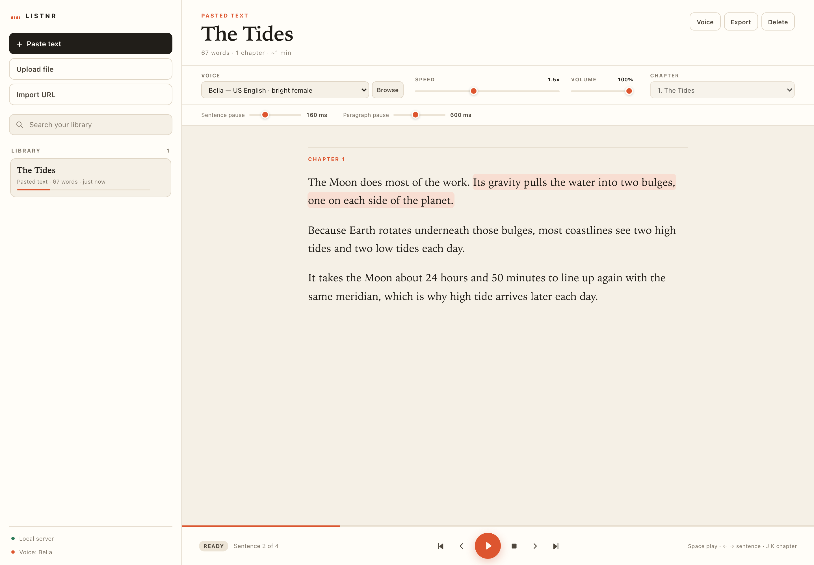
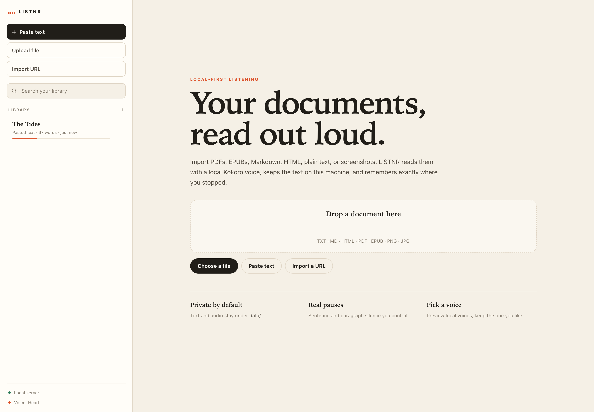
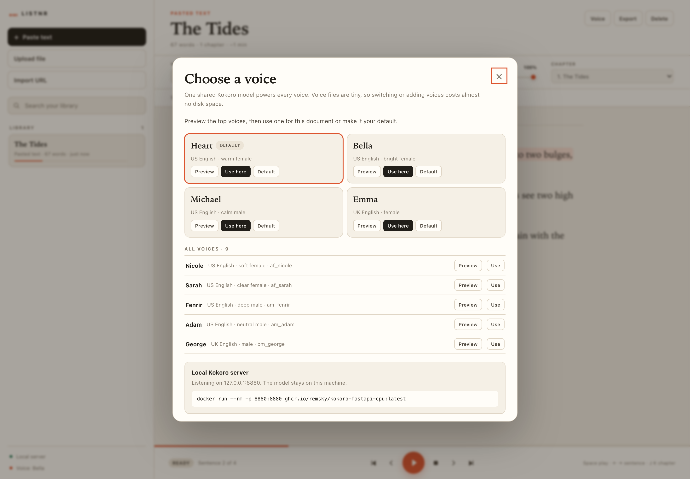
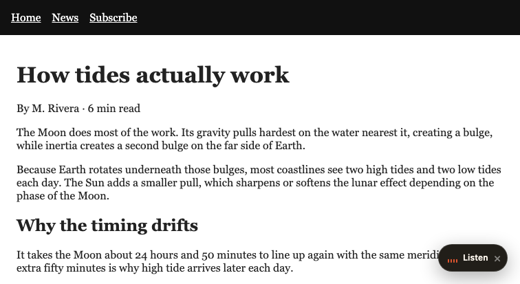
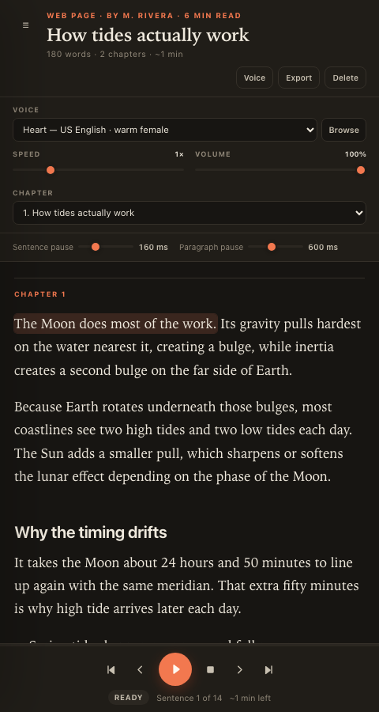

# LISTNR

**A local-first document reader that covers Speechify's core loop — as a Chrome extension and a local web app.**

A small **Listen** pill now appears on readable web pages. One click captures the page you are actually looking at — including pages behind a login — and opens it in a compact LISTNR reader. You can also paste text or import TXT, Markdown, HTML, PDF, EPUB, PNG, and JPEG from the library. LISTNR extracts chapters and paragraphs, reads them with a **local Kokoro voice** in sentence-sized chunks, highlights the sentence as it plays, keeps your place in SQLite, and never sends your library to a server you do not own.

No account. No subscription. No hosted speech API. No API key. No telemetry.



## Quick start

**Option A — Docker Compose (includes the local voice server):**

```bash
git clone https://github.com/songsbyarchit/Listener.git
cd Listener
docker compose up -d --build
```

Open **http://127.0.0.1:8787** — or load this folder as an unpacked Chrome extension at `chrome://extensions` and click the LISTNR toolbar icon.

**Option B — Node + your own Kokoro server:**

```bash
npm ci
docker run --rm -p 8880:8880 ghcr.io/remsky/kokoro-fastapi-cpu:latest
npm start
```

Full instructions, Docker notes, Apple Silicon guidance, backup, and troubleshooting: **[INSTALL.md](INSTALL.md)**.

---

## What it does

- **Import**
  - Pasted text
  - `.txt`, `.md` / `.markdown`
  - `.html` / `.htm` / `.xhtml`
  - `.pdf`
  - `.epub`
  - `.png`, `.jpg`, `.jpeg` via local OCR
  - Public web pages by URL (with private-network blocking)
- **Extraction**
  - Mozilla Readability for HTML
  - PDF.js for PDFs (text-layer PDFs; scanned PDFs need image OCR)
  - epub.js for EPUBs (spine order + navigation labels)
  - Tesseract.js for image OCR, using local traineddata
  - Headings, lists, quotes, code, and captions are preserved
  - Content is normalized into **chapters → paragraphs → sentences**
- **Listening**
  - Sentence-sized requests to a local OpenAI-compatible Kokoro endpoint
  - Returned audio is cached by text + voice; repeated sentences cost no synthesis
  - One-sentence prefetch and an 8-entry browser audio cache
  - Play, pause, stop, previous/next sentence, previous/next chapter
  - Click any sentence or paragraph to start there
  - Playback rate 0.5×–3× (pitch preserved) and volume, saved per document
  - Explicit sentence and paragraph pauses (defaults 160 ms / 600 ms), scaled down at faster speeds
  - Current sentence highlighted and scrolled into view
- **Library**
  - Recent documents with progress
  - Full-text search across titles and extracted text
  - Delete document + original upload
  - Plain-text export
  - Extracting / ready / playing / paused / finished / recoverable-error states
- **Local storage**
  - SQLite (`better-sqlite3`, WAL) for metadata, extracted text, position, settings, default voice
  - Original uploads and cached speech under `data/`
- **Read the page you're on**
  - Floating **Listen** pill on readable `http(s)` pages
  - Captures the current DOM (so logged-in pages work), not just the public URL
  - Opens Chrome's side panel when available, otherwise a compact reader window
  - `Alt+Shift+L` (Option+Shift+L on macOS) does the same from the keyboard
  - The captured page becomes a normal library document
- **Chrome extension**
  - Toolbar action opens the library/reader as an extension page
  - Talks to `http://127.0.0.1:8787` through host permissions
  - The same UI is served by Express at `/` if you prefer a web tab

### Screens

| Library | Voices |
| --- | --- |
|  |  |

| Listen pill on any page | Compact page reader |
| --- | --- |
|  |  |

---

## Voices and app size

Kokoro is one shared 82M-parameter model. **Voices are not separate models** — each voice is a small embedding file.

From the official ONNX model repository:

| Piece | Size |
| --- | ---: |
| Shared Kokoro model (`model_q8f16.onnx`) | **82.05 MB** |
| Every individual voice (`voices/*.bin`) | **0.5 MB** |
| Four starters (Heart, Bella, Michael, Emma) | **~2 MB** |
| All 54 voices | **~27 MB** |
| LISTNR extension zip | **46 KB** |
| LISTNR server source zip | **~1.0 MB** |
| Installed Node dependencies (PDF/EPUB/HTML/OCR) | **~226 MB** |
| Kokoro-FastAPI Docker image | large (Python + ONNX runtime), pulled once |

So the “50–80 MB app” intuition is right — but that 80 MB is the **shared model**, not three or four speakers. Choosing four voices costs about 2 MB because they reuse the same model. In LISTNR, voices live in the Kokoro server; **Browse** shows every voice the server exposes, and adding one does not grow the extension.

Suggested starters:

| Voice | Character |
| --- | --- |
| `af_heart` | Warm US female (default) |
| `af_bella` | Bright US female |
| `am_michael` | Calm US male |
| `bf_emma` | UK female |
| `bm_george` | UK male |

Open **Voice → Browse** to preview, use a voice for this document, or set it as the default for new imports.

> macOS system voices are not used here. If Chrome’s built-in voice sounds robotic, that is usually a compact OS voice — LISTNR avoids it by using Kokoro. You can still install macOS Premium/Enhanced voices for other apps.

---

## How it works

```text
Chrome extension page  ─────────────┐
                                   ├── HTTP ──► Express (127.0.0.1:8787)
Local web UI (same files) ─────────┘               │
                                                   ├─ SQLite (better-sqlite3)
                                                   ├─ parsers: Readability, PDF.js,
                                                   │  epub.js, Tesseract.js
                                                   ├─ SSRF-safe URL import
                                                   └─ /audio/:sentence
                                                          │
                                                          ▼
                                              Kokoro-FastAPI
                                        (OpenAI-compatible, local)
```

- The extension and web UI share `ui/`; there is no build step and no framework.
- The extension has only `tabs` permission plus host permissions for `127.0.0.1` / `localhost`.
- Sentence text is sent to **your own** Kokoro endpoint. Audio comes back and is cached under `data/audio`; nothing goes to a third party.
- Reading position and settings are saved after sentence changes and on page hide; reopening or restarting the server resumes exactly there.
- Pauses are scheduled between sentences by the UI, so paragraphs genuinely breathe instead of relying on punctuation alone.

## Import and URL security

- Uploads are limited to **30 MB** and a supported extension list; saved filenames are generated UUIDs, original names are sanitized for display.
- URL import allows only public `http(s)` pages:
  - blocks loopback, private, link-local, CGNAT, multicast, documentation, and IPv6 local ranges
  - blocks `localhost`, `.local`, `.internal`, `.lan`, and metadata hostnames
  - resolves DNS and rejects any private result
  - follows redirects manually and revalidates every hop
  - pins the HTTP connection to the validated address to reduce DNS rebinding
  - limits response size and time
- URL import is the only outbound network call. Everything else stays local.

## Privacy and data

- Server binds `127.0.0.1` by default. Docker publishes only `127.0.0.1:8787` on the host.
- No accounts, analytics, billing, telemetry, or public hosting.
- No hosted speech API and no API key.
- Data lives in `./data/` (`listnr.db`, `uploads/`, `audio/`, `tessdata/`).
- **Backup:** stop the server, copy `data/`.
- **Delete a document:** use the Delete button (row, extracted text, position, original upload). Cached audio is shared by text+voice and is pruned LRU.
- **Delete everything:** stop the server and remove `data/`.

See [INSTALL.md](INSTALL.md) for every environment variable and data-location detail.

## Supported formats

| Format | Parser | Notes |
| --- | --- | --- |
| Paste / TXT | paragraph splitter | Blank-line paragraphs, line-wrapped fallback |
| Markdown | marked → HTML → block extractor | Headings, lists, quotes, code |
| HTML | Mozilla Readability + jsdom | Nav/ads/comments stripped |
| PDF | PDF.js | Text-layer PDFs; headings detected by font size/gaps |
| EPUB | epub.js + jsdom | Spine order, navigation labels, metadata |
| PNG / JPG / JPEG | Tesseract.js | English traineddata cached locally |
| Public URL | safe fetch + Readability | SSRF protections above |

Limits: 30 MB uploads, 8 MB URL responses, 2,000,000 pasted characters.

## Tests

```bash
npm ci
npm test
```

Result from this build:

```text
ℹ tests 24
ℹ pass 24
ℹ fail 0
```

Focused suites:

```bash
node --test tests/parsers.test.js
node --test tests/normalize.test.js
node --test tests/ssrf.test.js
node --test tests/position.test.js
node --test tests/voices.test.js
node --test tests/page-import.test.js
node --test tests/e2e.test.js
```

The E2E test imports a file, fetches synthesized speech, saves a position, restarts the app against the same SQLite data, and verifies the position/settings resume. Parsers are tested against real PDF, EPUB, HTML, Markdown, text, and PNG fixtures — including a real local Tesseract OCR pass. The page-capture tests cover DOM imports with login-only content and plain-text fallback. The UI was also exercised in Chrome for Testing against a real Kokoro server: paste import, Markdown upload/extraction polling, library, playback/advance, pause/resume, sentence skip, voice preview/switch, save, reload/resume, the extension-page CORS path, and the floating Listen pill → page capture → reader window flow.

## Project layout

```text
manifest.json              MV3 extension manifest
extension/background.js    Page import, side panel/window, routing, commands
extension/page-reader.js   Floating Listen pill + current-page DOM capture
ui/                        Shared vanilla JS/CSS UI (extension + web)
ui/panel.html              Side-panel variant of the reader UI
server/
  index.js                 Loopback server entry
  app.js                   Express app, imports, library, audio routes
  db.js                    SQLite schema and queries
  normalize.js             Chapters, paragraphs, sentences, plain text
  ssrf.js                  Public-URL validation + pinned fetch
  tts.js                   Kokoro client, audio cache, voice list
  parsers/                 HTML, Markdown, text, PDF, EPUB, image OCR
  files.js                 Upload storage, safe names, limits
tests/                     node:test suites and fixtures
Dockerfile                 Node 22 server image
docker-compose.yml         LISTNR + Kokoro CPU
scripts/package-release.sh Release archives
docs/screenshots/          README images
```

## Deliberately not included

Mobile apps, cross-device sync, a hosted voice catalog, voice cloning, voice typing, AI podcasts, document chat, accounts, billing, telemetry, and public hosting. The server is a single-user local tool.

## Credits

- [Kokoro-82M](https://huggingface.co/hexgrad/Kokoro-82M) by hexgrad
- [Kokoro-FastAPI](https://github.com/remsky/Kokoro-FastAPI) — local OpenAI-compatible voice server
- [Mozilla Readability](https://github.com/mozilla/readability), [PDF.js](https://mozilla.github.io/pdf.js/), [epub.js](https://github.com/futurepress/epub.js), [Tesseract.js](https://github.com/naptha/tesseract.js)
- Node.js, Express, better-sqlite3, jsdom, marked

No license has been chosen yet. Treat the code as all rights reserved until one is added.
