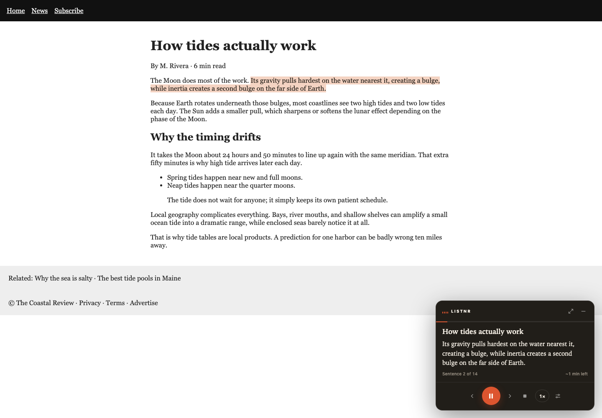

# listnr

**A local-first page reader for Chrome — it reads the page you are on, without leaving it.**

A small **Listen** pill appears on readable web pages. One click captures the page you are actually looking at — including pages behind a login — and plays it **without leaving the page**: an in-page panel gives you play/pause, sentence skip, speed, voice, volume, and pauses, while the current sentence is highlighted directly on the page. The LISTNR **toolbar popup** holds the shared playback settings — voice, speed, volume, pauses, and follow-highlight — and every page you listen to uses them. LISTNR reads with a **local Kokoro voice** in sentence-sized chunks, keeps your reading position in SQLite, and never sends your library to a server you do not own.

No account. No subscription. No telemetry. Local voices by default — and if you want a hosted voice, you can bring your own ElevenLabs or OpenAI-compatible key.

> **This version is extension-only.** There is no separate library/reader window or local web app: the toolbar popup and the in-page player are the whole UI. The standalone app may return in a later version.



## System-wide listnr

There is also a menu-bar app in `mac/`. Select text in any app and press
**⌥L**; it reads with the Mac's British English voice and shows a small
non-activating bubble with Pause and Stop. The Chrome extension remains the
page reader with highlighting and Kokoro or hosted voices.

```bash
cd mac
make run
```

## Quick start

**Option A — Docker Compose (includes the local voice server):**

```bash
git clone https://github.com/songsbyarchit/Listener.git
cd Listener
docker compose up -d --build
```

Load this folder as an unpacked Chrome extension at `chrome://extensions`, then click the LISTNR toolbar icon for playback settings and **Read this page**.

**Option B — Node + your own Kokoro server:**

```bash
npm ci
docker run --rm -p 8880:8880 ghcr.io/remsky/kokoro-fastapi-cpu:latest
npm start
```

Full instructions, Docker notes, Apple Silicon guidance, backup, and troubleshooting: **[INSTALL.md](INSTALL.md)**.

---

## What it does

- **Read the page you're on**
  - **Listen** pill that snaps to the left, right, or bottom edge and opens the player where it was last left
  - The open player can be dragged anywhere on the page and resized from its edges or corners; its spot and size are remembered
  - Captures the current DOM (so logged-in pages work), not just the public URL
  - **In-page player** with play/pause, sentence skip, stop, speed, voice, volume, and pauses
  - **Highlight overlay** follows the current sentence directly on the page
  - Minimize keeps playing
  - `Alt+Shift+L` (Option+Shift+L on macOS) starts it from the keyboard
  - The captured page is stored server-side, so its position and cached audio survive reloads
- **Toolbar popup**
  - **Read this page** starts LISTNR on the current tab
  - Shared playback settings — voice, speed, volume, sentence/paragraph pauses, follow-highlight — saved in `chrome.storage.local` and applied to every page
  - Live local-server status and the voice list
- **Listening**
  - Sentence-sized requests to a local OpenAI-compatible Kokoro endpoint
  - Returned audio is cached by text + voice; repeated sentences cost no synthesis
  - One-sentence prefetch and an 8-entry browser audio cache
  - Play, pause, stop, previous/next sentence
  - Playback rate 0.5×–3× (pitch preserved) and volume
  - Explicit sentence and paragraph pauses (defaults 160 ms / 600 ms), scaled down at faster speeds
  - Current sentence highlighted and scrolled into view
- **Local storage**
  - SQLite (`better-sqlite3`, WAL) for metadata, extracted text, position, settings, default voice
  - Original uploads and cached speech under `data/`
- **Server import and extraction** (API-level; there is no library window in this version)
  - Pasted text and `.txt`, `.md`, `.html`, `.pdf`, `.epub`, and `.png`/`.jpg` (local OCR)
  - Public web pages by URL (with private-network blocking)
  - Mozilla Readability for HTML, PDF.js, epub.js, Tesseract.js
  - Headings, lists, quotes, code, and captions are preserved
  - Content is normalized into **chapters → paragraphs → sentences**

### Screens

| Listen pill | In-page player + page highlight |
| --- | --- |
|  |  |

---

## Voices and app size

Kokoro is one shared 82M-parameter model. **Voices are not separate models** — each voice is a small embedding file.

From the official ONNX model repository:

| Piece | Size |
| --- | ---: |
| Shared Kokoro model (`model_q8f16.onnx`) | **82.05 MB** |
| Every individual voice (`voices/*.bin`) | **0.5 MB** |
| Four starters (Heart, Bella, Michael, Emma) | **~2 MB** |
| All 54 voices | **~27 MB** |
| LISTNR extension zip | **55 KB** |
| LISTNR server source zip | **~1.2 MB** |
| Installed Node dependencies (PDF/EPUB/HTML/OCR) | **~226 MB** |
| Kokoro-FastAPI Docker image | large (Python + ONNX runtime), pulled once |

So the “50–80 MB app” intuition is right — but that 80 MB is the **shared model**, not three or four speakers. Choosing four voices costs about 2 MB because they reuse the same model. In LISTNR, voices live in the Kokoro server; the popup lists every voice the server exposes, and adding one does not grow the extension.

Suggested starters:

| Voice | Character |
| --- | --- |
| `af_heart` | Warm US female (default) |
| `af_bella` | Bright US female |
| `am_michael` | Calm US male |
| `bf_emma` | UK female |
| `bm_george` | UK male |

Pick a voice in the LISTNR toolbar popup (or the player's gear menu). The choice is shared across every page; no per-document voice setup is needed.

> macOS system voices are not used here. If Chrome’s built-in voice sounds robotic, that is usually a compact OS voice — LISTNR avoids it by using Kokoro. You can still install macOS Premium/Enhanced voices for other apps.

## Use a hosted voice (optional)

LISTNR ships with **no key and no hosted voice**. If you would rather use ElevenLabs, OpenAI, or any OpenAI-compatible endpoint, configure the server environment — there is no hosted-voice screen in this extension-only build:

1. Stop the server.
2. Start it with `TTS_PROVIDER` (`elevenlabs`, `openai`, or `custom`), `TTS_API_KEY`, and, where needed, `TTS_BASE_URL` / `TTS_MODEL`.
3. Reload the extension popup; its voice list now comes from that account.

See [INSTALL.md](INSTALL.md#connecting-a-hosted-voice-optional) for the exact commands.

**How the key is stored.** With environment variables the key lives only in the process environment (or your `.env`/Compose configuration). If a key was saved by an earlier version, it lives in `data/listnr.db`, readable only by your account (`0600`), and is never returned by the API. It is sent only to the provider origin it was saved for.

**What leaves the machine.** With a hosted provider, the text you listen to is sent to that provider. Nothing else is. LISTNR still speaks sentence by sentence so playback, highlighting, and resume-at-the-exact-sentence keep working; for ElevenLabs it also sends the surrounding paragraph as `previous_text`/`next_text` so each sentence is voiced in the context of the passage (that context is not spoken and is not billed). ElevenLabs requests set `enable_logging=false` so the text is not kept in its history.

**What it costs.** Roughly 56,000 characters is one hour of audio. LISTNR caches each synthesized sentence under `data/audio`, so re-listening is free and only new text or a new voice bills again.

| Option | Price | 10k-word article (~60k chars) | 90k-word book (~550k chars) |
| --- | --- | ---: | ---: |
| Local Kokoro | **$0** | $0 | $0 |
| OpenAI `tts-1` / `gpt-4o-mini-tts` | ~$15–20 / 1M chars | ~$0.90–1.20 | ~$8–11 |
| OpenAI `tts-1-hd` | $30 / 1M chars | ~$1.80 | ~$16.50 |
| ElevenLabs Flash/Turbo | ~0.5 credits per character | ~$2.40–6 | ~$22–50 |
| ElevenLabs Multilingual v2/v3 | ~1 credit per character | ~$5–12 | ~$44–110 |

ElevenLabs plans, for scale: Free 10k credits ≈ 11 min/month · Starter $6 = 30k ≈ 32 min · Creator $22 = 121k ≈ 2.1 h · Pro $99 = 600k ≈ 10.7 h. Prices change; check the provider.

> OpenAI retires `gpt-4o-mini-tts`, `tts-1`, and `tts-1-hd` on **6 January 2027**, and the replacement does not use `/v1/audio/speech`. The OpenAI preset will stop working then; `TTS_PROVIDER=custom` with an OpenAI-compatible base URL is the durable path.

To go back to free local speech, restart the server with `TTS_PROVIDER=kokoro` and no key.

---

## How it works

```text
Toolbar popup (settings) ───────────┐
                                    ├── HTTP ──► Express (127.0.0.1:8787)
In-page player (content script) ────┘               │
                                                     ├─ SQLite (better-sqlite3)
                                                     ├─ parsers: Readability, PDF.js,
                                                     │  epub.js, Tesseract.js
                                                     ├─ SSRF-safe URL import
                                                     └─ /audio/:sentence
                                                            │
                                                            ▼
                                                Kokoro-FastAPI
                                          (OpenAI-compatible, local)
```

- The extension has no build step and no framework: `ui/popup.*` is the toolbar popup, `extension/page-reader.js` is the in-page player.
- Permissions are `tabs`, `storage`, `scripting`, and `activeTab`, plus host permissions for `127.0.0.1` / `localhost`.
- Sentence text is sent to **your own** Kokoro endpoint by default. If you connect a hosted provider, only that sentence (plus nearby paragraph context for ElevenLabs) goes to the provider you chose. Audio comes back and is cached under `data/audio`.
- Reading position and playback settings are saved after sentence changes and on page hide; reopening or restarting the server resumes exactly there.
- Pauses are scheduled between sentences by the UI, so paragraphs genuinely breathe instead of relying on punctuation alone.

## Import and URL security

- Uploads are limited to **30 MB** and a supported extension list; saved filenames are generated UUIDs, original names are sanitized for display.
- URL import allows only public `http(s)` pages:
  - blocks loopback, private, link-local, CGNAT, multicast, documentation, and IPv6 local ranges
  - blocks `localhost`, `.local`, `.internal`, `.lan`, and metadata hostnames
  - resolves DNS and rejects any private result
  - follows redirects manually and revalidates every hop
  - pins the HTTP connection to the validated address to reduce DNS rebinding
  - limits response size and time
- In the default local setup, URL import is the only outbound network call. If you connect a hosted voice provider, speech requests to that provider are the other one.

## Privacy and data

- Server binds `127.0.0.1` by default. Docker publishes only `127.0.0.1:8787` on the host.
- No accounts, analytics, billing, telemetry, or public hosting.
- Local speech by default. Hosted voices are opt-in and use a key you supply; the text you listen to is sent only to the provider you configure.
- Data lives in `./data/` (`listnr.db`, `uploads/`, `audio/`, `tessdata/`).
- **Backup:** stop the server, copy `data/`.
- **Delete a document:** there is no library window in this version; stop the server and remove the document's rows from `data/listnr.db`. Cached audio is shared by text+voice and is pruned LRU.
- **Delete everything:** stop the server and remove `data/`.

See [INSTALL.md](INSTALL.md) for every environment variable and data-location detail.

## Supported formats

| Format | Parser | Notes |
| --- | --- | --- |
| Paste / TXT | paragraph splitter | Blank-line paragraphs, line-wrapped fallback |
| Markdown | marked → HTML → block extractor | Headings, lists, quotes, code |
| HTML | Mozilla Readability + jsdom | Nav/ads/comments stripped |
| PDF | PDF.js | Text-layer PDFs; headings detected by font size/gaps |
| EPUB | epub.js + jsdom | Spine order, navigation labels, metadata |
| PNG / JPG / JPEG | Tesseract.js | English traineddata cached locally |
| Public URL | safe fetch + Readability | SSRF protections above |

Limits: 30 MB uploads, 8 MB URL responses, 2,000,000 pasted characters.

## Tests

```bash
npm ci
npm test
```

Result from this build:

```text
ℹ tests 32
ℹ pass 32
ℹ fail 0
```

Focused suites:

```bash
node --test tests/parsers.test.js
node --test tests/normalize.test.js
node --test tests/ssrf.test.js
node --test tests/position.test.js
node --test tests/voices.test.js
node --test tests/page-import.test.js
node --test tests/e2e.test.js
```

The E2E test imports a file, fetches synthesized speech, saves a position, restarts the app against the same SQLite data, and verifies the position/settings resume. Parsers are tested against real PDF, EPUB, HTML, Markdown, text, and PNG fixtures — including a real local Tesseract OCR pass. The page-capture tests cover DOM imports with login-only content and plain-text fallback. The extension itself was exercised in Chrome for Testing against a real Kokoro server: the toolbar popup, page import, in-page playback, page highlight, speed/voice settings, and minimize-while-playing.

## Project layout

```text
manifest.json              MV3 extension manifest
extension/background.js    Page import, audio and voice bridge, toolbar message routing
extension/page-reader.js   Listen pill, in-page player, page highlight, DOM capture
ui/popup.html              Toolbar popup: Read this page + shared playback settings
ui/popup.js
ui/popup.css
server/
  index.js                 Loopback server entry
  app.js                   Express API, imports, audio routes
  db.js                    SQLite schema and queries
  normalize.js             Chapters, paragraphs, sentences, plain text
  ssrf.js                  Public-URL validation + pinned fetch
  tts.js                   Voice client (Kokoro / ElevenLabs / OpenAI-compatible), cache
  tts-providers.js         Provider presets, API-key storage, validation
  parsers/                 HTML, Markdown, text, PDF, EPUB, image OCR
  files.js                 Upload storage, safe names, limits
tests/                     node:test suites and fixtures
Dockerfile                 Node 22 server image
docker-compose.yml         LISTNR + Kokoro CPU
scripts/package-release.sh Release archives
docs/screenshots/          README images
```

## Deliberately not included

Mobile apps, cross-device sync, a hosted voice catalog, voice cloning, voice typing, AI podcasts, document chat, accounts, billing, telemetry, and public hosting. The server is a single-user local tool.

## Credits

- [Kokoro-82M](https://huggingface.co/hexgrad/Kokoro-82M) by hexgrad
- [Kokoro-FastAPI](https://github.com/remsky/Kokoro-FastAPI) — local OpenAI-compatible voice server
- [Mozilla Readability](https://github.com/mozilla/readability), [PDF.js](https://mozilla.github.io/pdf.js/), [epub.js](https://github.com/futurepress/epub.js), [Tesseract.js](https://github.com/naptha/tesseract.js)
- Node.js, Express, better-sqlite3, jsdom, marked

No license has been chosen yet. Treat the code as all rights reserved until one is added.
